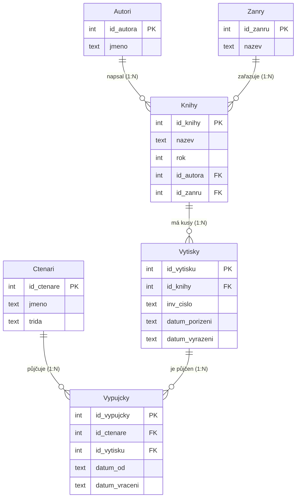

# Knihovna (vzorový projekt)

Takhle může vypadat ročníkový projekt. Téma Knihovna si nevybírejte, je jen vzor.

**Co se eviduje:** školní knihovna. Knihy, jejich výtisky (kusy), čtenáři a kdo si co půjčil.

## Schéma


- Autor má víc knih a žánr má víc knih (1:N).
- Kniha má víc výtisků, každý má své inventární číslo (1:N).
- Čtenář si půjčí víc výtisků a výtisk si postupně půjčí víc čtenářů (M:N). Proto je mezi nimi tabulka `Vypujcky`.

## Co zadání chce a kde to je
| Požadavek zadání | Minimum | Vzor | Kde |
|---|---|---|---|
| Tabulky, každá s primárním klíčem | 4 | 6 | `sql/01_schema.sql` |
| Vztah 1:N | 1 | 5 | `sql/01_schema.sql` |
| Vztah M:N přes spojovací tabulku | 1 | 1 (`Vypujcky`) | `sql/01_schema.sql` |
| Data v hlavních tabulkách | 8 řádků | 8 až 22 | `sql/02_data.sql` |
| Data ve spojovací tabulce | 10 řádků | 20 | `sql/02_data.sql` |
| SQL dotazy | 10 | 10 | `sql/03_dotazy.sql` |
| Použití AI | napsat | ano | `AI.md` |
| Web nad databází | dobrovolný | ano | `index.html` |

Splnit zadání stačí na minimum. Vzor je záměrně bohatší, abyste viděli, jak vypadá dobrá práce. Nemusíte ho dosáhnout.

## Jak to ukázat
1. Otevřete `index.html` v prohlížeči. Když se zeptá na SQL soubory, vyberte složku `sql`.
2. Záložka **Přehled** ukáže schéma a tabulky, každá další záložka jednu tabulku, záložka **SQL** zkouší dotazy a záložka **Dokumentace** ukáže tenhle text.
3. Bez webu stačí pustit tři soubory ze složky `sql` v programu DB Browser for SQLite.

## Co kde je
```
README.md          téma, schéma, jak spustit
AI.md              použití AI
index.html         web (dobrovolný, nesahejte na něj)
sql/               01_schema.sql, 02_data.sql, 03_dotazy.sql
docs/schema.png    obrázek schématu
web/               kód webu (nesahejte na něj)
```

## Co se kdy odevzdává (značky v Gitu)
| Krok | V repozitáři | Značka |
|---|---|---|
| 1. Téma | `README.md` s tématem a jednou větou | `K1` |
| 2. Návrh a data | `sql/01_schema.sql`, `sql/02_data.sql`, `docs/schema.png` | `K2` |
| 3. Dotazy | `sql/03_dotazy.sql` | `K3` |
| 4. Finále | hotové README, `AI.md`, případně web | `K4` |

Značku uděláte příkazem `git tag K2` a odešlete `git push --tags`. Screenshoty a video patří na OneDrive, ne do repozitáře.
